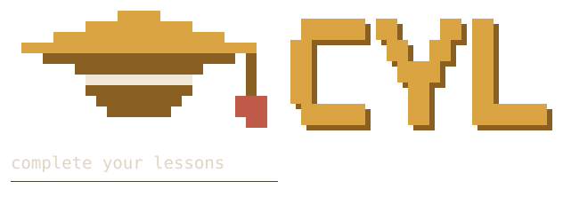

# cyl — Complete Your Lessons

<picture>
  <source media="(prefers-color-scheme: dark)" srcset="assets/cyl-dark.png">
  
</picture>

[](https://python.org)
[](LICENSE)
[](#setup)
[](cyl.py)
[](cyl.py)

#### *c4mpus shows you a percentage. cyl shows you what to actually do about it.*

cyl is a single-file terminal client for [c4mpus.com](https://c4mpus.com). It reads
your whole enrolment at once and reports more detailed and more accurate
statistics about your module progress than c4mpus itself does, then marks lessons
complete in bulk
through the same API the website uses.

## Why This Exists

c4mpus can tell you a module is at 83%. It cannot tell you *which* lessons are
missing, how that compares to your other modules, or which ones are a lesson away from
done, and nothing it shows spans more than one module at a time. cyl puts all of it
on one screen, with stricter numbers: `100%` means every lesson is genuinely done, so
`686/689` reads `99%` rather than rounding up.

The other half is the clicking. On the website each lesson is one click through a page
that reloads between every action, so seventy outstanding lessons is seventy round
trips. cyl does that part in bulk: in order, throttled, and only after you have seen
the plan and confirmed it.

> **cyl is not a shortcut around studying.** Nothing it does will teach you the
> material. Read the course content, do the work, earn the understanding. Then let
> cyl take the part that was never learning in the first place: clicking *mark as
> complete* several hundred times.

> **Completions are real and there is no undo.** They hit your actual c4mpus account
> the moment you confirm, and the API offers no way back. `status` only ever reads,
> and `--dry-run` prints the plan while sending nothing. Use both freely.

## Setup

You need a c4mpus account, a terminal, and Python 3.8 or newer. Nothing else;
cyl uses only the standard library.

**1. Check Python is there**
```bash
python3 --version
```
Anything from `3.8` up is fine. On Windows `python3` often doesn't exist, so use `py`
instead, everywhere in this guide. If you get `command not found`, install from
[python.org](https://www.python.org/downloads/) and on Windows tick
**"Add Python to PATH"**. It's easy to miss, and nothing works without it.

**2. Clone the repository**
```bash
git clone https://github.com/saradk5/cyl.git
cd cyl
```
No `git`? cyl is one file, so you can grab it on its own:
```bash
curl -O https://raw.githubusercontent.com/saradk5/cyl/main/cyl.py
```
Or download [`cyl.py`](https://github.com/saradk5/cyl/blob/main/cyl.py) from the
repository page and `cd` to wherever you saved it. Run `ls` (or `dir` on Windows) and
you should see `cyl.py`.

**3. Log in**
```bash
python3 cyl.py login
```
cyl prints the steps and takes the token off your clipboard. See
[Your token](#your-token) for where it lands and how to revoke it.

**4. Look around (this changes nothing)**
```bash
python3 cyl.py status
```

**5. Run it properly**
```bash
python3 cyl.py
```
With no arguments you get the guided menu, which is the best way in.

Optionally, make it executable and drop the `python3` for good:
```bash
chmod +x cyl.py
./cyl.py
```

## Commands

| Command | What it does |
| --- | --- |
| *(none)* | the interactive menu, the recommended way in |
| `login` | get and save a token; `--snippet` prints just the JavaScript |
| `logout` | delete the saved token from this machine |
| `modules` | one line per enrolled module: year, slug, title |
| `status` | the progress dashboard |
| `lessons` | every lesson with its completion mark |
| `complete` | mark lessons complete without the menu |

```bash
python3 cyl.py status --all                       # everything
python3 cyl.py lessons -m digital-forensic        # a unique substring is enough
python3 cyl.py complete -m crypto -m forensic     # -m repeats
python3 cyl.py complete --all --dry-run           # print the plan, send nothing
python3 cyl.py complete -m crypto --redo          # re-send completed lessons too
```

Any substring matching exactly one module works. Match several and cyl lists the
candidates and stops rather than guessing. `status` with no target covers everything;
`lessons` and `complete` deliberately require `-m` or `--all`, so a bare `complete`
can never touch your whole degree by accident.

## Options

| Flag | Default | Purpose |
| --- | --- | --- |
| `--token '<jwt>'` | — | use this token instead of the saved one |
| `--delay` | `0.4` | seconds between lessons |
| `--dwell` | `0.25` | seconds between *start* and *mark complete* |
| `-y`, `--yes` | off | skip confirmations; **use with care** |
| `-n`, `--dry-run` | off | `complete` only: show the plan, send nothing |
| `--redo` | off | `complete` only: include already-completed lessons |
| `-q`, `--quiet` | off | hide the banner |
| `--no-color` | off | plain text; `NO_COLOR` and `TERM=dumb` also respected |
| `--theme` | `gold` | `gold`, `mono`, `blueprint`, `plum` |
| `--bar` | `boxes` | `boxes` ■□, `blocks` ▰▱, `solid` █░ |
| `--version` | — | print the version and exit |
| `-h`, `--help` | — | built-in help; works after a command too |

## Your token

c4mpus identifies you with a **JWT**, a long string your browser receives when you
log in. It works like a temporary key. `cyl login` saves it to `~/.c4mpus_token`
with mode `600`, readable only by your own user account.

**Your token is stored locally and goes nowhere else.** It stays on your machine, is
sent only to `api.c4mpus.com` as the `Authorization` header on your own requests, and
is transmitted to no one else. There is no cyl server, no telemetry, and no third
party anywhere in the path. The browser snippet that lifts it out of your session
sends nothing either; it copies the token to your clipboard and stops there. Treat it
like a password: it *is* access to your account.

cyl looks for one in this order, first found wins:

| Source | Notes |
| --- | --- |
| `--token '<jwt>'` | one-off, highest priority |
| `$CYL_TOKEN` | handy for a script or shell function |
| `$C4MPUS_TOKEN` | alias for the same thing |
| `~/.c4mpus_token` | what `cyl login` writes, mode `600` |

Every run shows you the clock, and an expired token is discarded automatically:

```
  ✓ Jane Doe (123456)  token valid 6d 17h · until 22 Oct 15:02
```

```bash
python3 cyl.py logout      # deletes ~/.c4mpus_token on this machine only
```

**`logout` is housekeeping, not revocation.** A JWT stays valid until its own expiry
no matter what you delete locally. **To actually kill one, log out of c4mpus in your
browser.** That expires it immediately, everywhere.

## Limits

- **A module listed in two years** is attributed to the first year it appears in.
- **cyl marks lessons, not assessments.** Coursework is untouched; the dashboard only
  counts it so you know it's there.

## Disclaimer

cyl is an unofficial client. It is not affiliated with, endorsed by, or supported by
c4mpus, or by any institution that uses it.

It is intended for use with your own account and your own enrolment. You are
responsible for ensuring that your use of it complies with your institution's academic
integrity policy and with the c4mpus terms of service. Running it against an account
you do not own, or using it in any way those rules forbid, is unauthorised use.

**Responsibility for how this tool is used rests entirely with the person using it.**
The repository owner and contributors accept no liability for any loss, damage,
academic penalty, or other consequence arising from its use or misuse, in any case.
The software is provided "as is", without warranty of any kind. See
[LICENSE](LICENSE).

## License

Licensed under the [Apache License 2.0](LICENSE). Copyright 2026 saradk5.

You may use, modify and redistribute cyl, including commercially, provided you retain
the license and copyright notice and state any significant changes you made. It is
distributed **without warranty of any kind**: sections 7 and 8 of the license disclaim
warranty and limit liability in full.

## Thank You

Thanks for checking out cyl. Feedback and contributions are always welcome.
